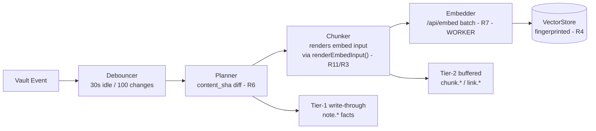
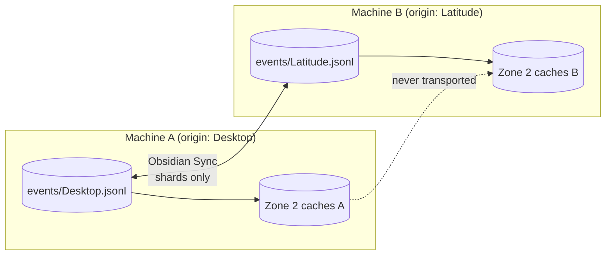
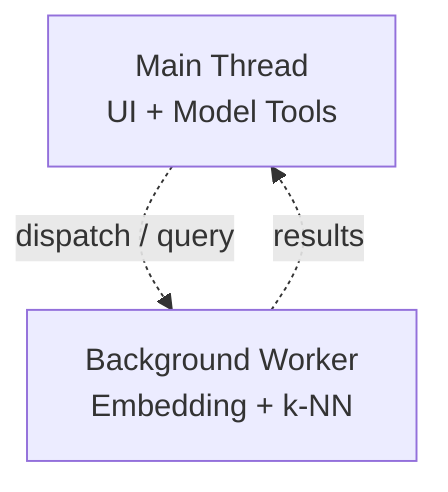

---
source:
status: living document
para:
context:
description:
Topics:
Concepts:
Meeting notes:
Permanent: false
type: note
word_count: 1
language: en
updated:
modified: 
---
# Vault Overseer — Architecture Map v0.5 (rev. 2026-11-01)

Updated 2026-11-01 (F15 FTS lane fixture-green; F14 closure folded in)

> \[!abstract] Purpose Fix structural decisions before subsystem detail. Derived from autopsy of three incumbents, Obsidian Sync behavior verification, and the ratified schema family (Event Log Schema v0.2 rev. 2026-10-24, Chunker Spec v0.1, Event Log Fixture Corpus v0.1 rev. 2026-10-24). **Supersedes Map v0.4.** Changes from v0.4: F14 `folder.renamed` closed (fixture-certified + live receipts, 2026-10-30), F15 FTS5 projection + search shipped and fixture-certified (S1–S7, M1–M3, 53 checks — fleet now 14 suites, all green), `reader.ts` ported from `Buffer` to `TextDecoder` for mobile-runtime compatibility, and the reader (ParseLine) regression-receipted by F01–F03. **The FTS lane is fixture-green but NOT wired into `main.ts`** — wiring and live receipts are the new frontier. Consolidates F15's declared deviations, which live in `src/fts/store.ts`'s ledger, not here.

**Revision 2026-11-01 (F15 session close):** the FTS5 projection lane exists as code and proof, not yet as product. `src/fts/` (store, lane, mobile, probe, rebuild, search) fixture-certified via `f15.ts` — 53 checks, S1–S7 desktop + M1–M3 mobile, ALL GREEN. First contact was properly hostile: initial reds spanned erasable-TS syntax violations (constructor parameter properties — Node's `ERR_UNSUPPORTED_TYPESCRIPT_SYNTAX`), SQL statement routing (`better-sqlite3` `.all()` vs `.run()` on mutations, fixed by relocating SQL into `store.ts` doors), fixture-world realism (spine events without corresponding disk states, corrected against the disk-as-truth contract), and a concurrent-lane pump race (fixed with a single-flight `draining` flag). The lane is driven by `EventLog.subscribe()` onto a serialized work lane, rebuilds from present-day disk bytes via `chunkNote()` addressed by `projectPaths()`, probes staleness by `adapter.stat()` per shard — never by reading the spine — and the mobile read lane carries zero native imports (pure JS over the shared `reader.ts`). `reader.ts`'s `parseLine` was ported from `Buffer` to `TextDecoder` in the same session (Obsidian mobile lacks Node APIs; verified by search receipt, regression-receipted by F01–F03). **Wiring debt named, not hidden:** `makeFtsLane()` is not yet constructed in `main.ts` — no production witness exists for the FTS lane; fixture-green is not production-live.

**Revision 2026-10-30 (live receipt):** planner wiring **verified live in the test vault** — fresh-install origin certification exercised end-to-end (no `origin.txt` → settings demand → empty candidate list → new origin `Desktop` declared → writer live), 508-path first-contact backfill at watcher attach (shard born at 511 lines incl. reconcile notice), then spine gained `note.modified` × 4 and `note.opened` × 1 (seq 512–516, distinct `content_sha` per edit, actors correctly attributed). The owed `obsidian.d.ts` line citation is delivered: **line 10439, `on(name: 'modify', callback: (file: TAbstractFile) => any, ctx?: any): EventRef`** — the `TAbstractFile` callback shape typecheck asserted is now independently witnessed in the typings. Settings surface (origin certification + reconcile) verified rendering and functioning on cold install. Frontier reordered: **F14 `folder.renamed` promoted to slot 1** — its consumer condition was already met (F13), and the planner behind it is now production-proven. *(Post-rev close-out: F14 shipped, certified, and live-receipted the same day — see the 2026-11-01 revision.)*

**Revision 2026-10-29 (session close):** folds the subscriber-seam implementation and certification (slot 1 — F13: 30 checks, 5 scenarios green, one legitimate first-contact red), the subscriber-throw hazard ruling (integrity events never re-enter fanout), planner wiring into `main.ts` (slot 4 — adapter territory, awaiting live receipt), and the completed typecheck catch-up (44→0). Fleet: 12 suites, all green. Timestamp doctrine in force: docs outside the vault require manual body rev dates; frontmatter `modified:` is not evidence.

## Core Constraint from Transport Research

**Obsidian Sync ferry rules:**

* **Syncs everything** in the visible vault
* **Syncs only the canonical quartet** from plugin folders: `manifest.json`, `main.js`, `styles.css`, `data.json`
* **Non-canonical files in plugin folders are structurally excluded** — silent, no error, no retry

**Design consequence:** durable spine and recipes live in the visible vault; rebuildable derived caches live in the plugin folder, structurally excluded from sync. The exclusion is exploited, not fought.

## Zone Definitions

| Zone       | Location                                                        | Sync Behavior             | Contains                                                                                             | Rationale                                      |
| ---------- | --------------------------------------------------------------- | ------------------------- | ---------------------------------------------------------------------------------------------------- | ---------------------------------------------- |
| **Zone 1** | Visible vault (`_vault-index/`)                                 | **Full sync**             | `events/` (per-origin shards), `recipes/`, `skills/` (user overrides)                                | Spine + recipes survive machine switch         |
| **Zone 2** | Plugin folder (`.obsidian/plugins/vault-overseer-index/cache/`) | **Structurally excluded** | `vectors/`, `bm25/` (live since F15: `cache/bm25/index.db`, schema version stamped inside the DB, not the filename), `knn-graph/` | Rebuildable caches never travel — Zone 2 disposability contains the better-sqlite3 ABI failure mode: broken binary ⇒ search dark, spine unaffected, rebuild on repair |
| **Zone 3** | Plugin folder (`.obsidian/plugins/vault-overseer-index/`)       | **Quartet only**          | `data.json`, `manifest.json`, `main.js` — plus **non-canonical files, notably `origin.txt`** (below) | Settings only — no volatile runtime state (R8) |

> \[!note] Zone discipline (2026-10-29) Zone 3's "Contains" explicitly names `origin.txt`: it is a non-canonical file in the plugin folder root, structurally excluded from Sync and untouched by BRAT. That exclusion is what makes it safe to hold per-device identity. Zone discipline is policed by the log itself: `settings.changed` is the fire alarm, and chatty events there mean runtime state has crept into `data.json`.

## Identity — the Origin Ladder (added 2026-10-24)

The largest piece of architecture shipped since the map froze, previously unmapped: **per-device writer identity**, solved by exploiting the same structural exclusion Zone 2 exploits.

* **Rung 1 — `origin.txt` in the plugin folder.** Non-canonical, sync-excluded, BRAT-proof. If present and non-empty, that's the origin, period.
* **Rung 2 — no `origin.txt` ⇒ writer stays DARK.** The settings surface lists found shards and demands **human certification** (continue an existing shard or declare a new id; a virgin install gets an empty candidate list). No machine ever infers identity from synced state or from the OS. Certification is logged as `origin.migrated-interim`.
* **Rung 3 — deleted (0.1.2).** The former hostname-seeded fallback never called its own write function while claiming it had — a never-fabricate violation, dormant only because no machine ever took it. Identity-by-inference also contradicts the ladder's own principle. Deleted, not repaired.
* **Rung 4 — `data.json`'s origin field is NEVER read.** If ferried in by Sync, it is scrubbed on load and the scrub is logged (`settings.changed-interim`). Auto-lifting it would gamble identity on a sync-conflict coin toss — the S2B lesson, promoted to doctrine.

Shard names are the origin ids: `Desktop.jsonl`, `Latitude.jsonl` in production. A foreign origin value in a shard's tail blocks that machine's writer at startup — misconfigured duplicate ids fail loud, never write.

> \[!note] Rung 2 verified live (2026-10-30) Fresh test-vault install: no `origin.txt`, writer dark on boot, settings surface rendered correctly with an empty candidate list, new origin `Desktop` certified by hand, writer went live, reconcile backfilled 508 first-contact paths. The cold-install certification flow has a UI witness as well as a functional one — without that surface, the writer stays dark and no receipt is possible.

**Ladder design principles:** identity lives in exactly one place per machine (`origin.txt`), never rides Sync, and never gets fabricated. The map's zone model holds unchanged — the ladder is the zone rules _applied to a new fact class_.

## Indexing Pipeline

> \[!note] Implementation status (rev. 2026-11-01) **Shipped:** the spine (EventLog, writer, merge-scan, checkpoints, heal scan, dwell gate, rename wiring, **subscriber seam** — F13-certified: 30 checks, 5 scenarios) + **File watcher lane** (`src/watcher/watch.ts`, F12-certified) — Tier-1 facts created/deleted + automatic reconcile at writer attach + **Planner / `note.modified` lane** (F08-certified) **wired into `main.ts` and verified live 2026-10-30** (spine seq 512–516) + **`folder.renamed` transcription** (F14-certified 2026-10-30: `types.ts` serializer case, `projectPaths()` prefix-fold, planner rev B `cancelPrefix` ruling cancel-before-emit, `main.ts` folder-rename branch unmuted; live receipts on the test-vault spine seq 4814–4822 — chained folder renames, one O(1) line each, zero child explosion, `note.renamed` × 3 riding along) + **FTS5 projection + search lane** (`src/fts/`, F15-certified 2026-11-01: 53 checks, S1–S7 + M1–M3 all green — store/lane/mobile/probe/rebuild/search; seam-driven via `EventLog.subscribe()` onto a serialized single-flight work lane; stat-based staleness probe; rebuild from present-day disk bytes via `chunkNote()`; mobile pure-JS read lane, zero native imports; `reader.ts` ported to `TextDecoder`, regression-receipted F01–F03). **Hazard ruling (2026-10-29):** subscriber throws on integrity events are console-visible but never re-enter fanout — the shard cannot self-amplify. **Heal migrated to `chunkNote` geometry** (2026-10-26), **stub deleted** (2026-10-27, Phase 4). **Typecheck debt complete** (2026-10-29); `npm run typecheck` is a pre-commit ritual and the repo has been fully clean since. **Still pending:** FTS lane **wiring into `main.ts`** (real `FtsStore`, real adapter, arm/dispose lifecycle — fixture-green is not production-live; no production witness exists yet), embeddings + vector store (Phase 3). **Fleet: 14 suites, all green (2026-11-01).**

**Key invariants (v0.5):**

* Planner consults the event log first; unchanged content never re-embeds (same `content_sha` + mtime ⇒ no event, no seq consumed)
* Renames emit `note.renamed` and nothing else — `vh` is path-independent, chunks carry over untouched (R6)
* **The prefixer is not a pipeline stage.** Chunk rendering happens inside the chunker through the single shared `renderEmbedInput()` — one implementation, not two drifting copies (VC's lesson generalized)
* **Durability is classified:** Tier-1 events (file facts, writes, ops) write through immediately; Tier-2 events (chunks, links, embed batches) flush at 64 events / 3s idle / hard cap 512. Facts survive, derivatives heal
* **Subscriber seam** (v0.4, F13-certified): index tails, not polls; notification latency == persistence latency (Tier-2 notified only after flush to disk); subscribers receive in FIFO order; subscriber errors logged with attribution but never propagate to writer; integrity events never re-enter fanout. **Consumed by the FTS lane since F15** — the seam's first production-grade consumer
* **Spine is addressing, disk is content** (v0.5, F15): the FTS projection resolves paths through `projectPaths()` — one addressing authority, no third drifting copy — and derives content from present-day disk bytes via `chunkNote()`, never from the spine's `chunk.indexed` stream. The staleness probe is stat-based (`adapter.stat()` per shard vs. recorded `(origin, last_seq, byte_length)`); the probe never reads the spine. Gap ⇒ loud refusal, partial indexes never served as complete (F03/F02 doctrine)

**Additional shipped event sources (2026-10-24):** the dwell gate (`src/dwell/gate.ts` — pure module, injected clock/timer, emit via callback; `main.ts` is a thin adapter) produces `note.opened` (Tier 2) with v1 threshold semantics — F09-certified, **production-witnessed 2026-10-30** (test-vault spine, `note.opened` seq 514). Rename wiring (0.1.5-bound) produces `note.renamed` (Tier 1 write-through) on file renames and rewrites gate path lanes in the same handler. Both drop silently while the writer is dark — declared v1 limitation.

## Event Log Topology — the spine

One writer per shard — sync conflicts on the spine are eliminated **by construction** (not a setting, not a promise). Merge-scan orders by `(origin, seq)`; global `ts` is never trusted for ordering. Each machine derives its own caches from the same converged spine.

> \[!note] Naming (2026-10-29) v0.3's diagram said `mokka`/`latitude`; production shard names are **`Desktop.jsonl`** and **`Latitude.jsonl`** (live receipts, 2026-10-23/24). Diagram shows actuals.

**The Plugin 1 ↔ Plugin 2 seam:** Plugin 2 never writes the log directly. It appends via Plugin 1's exposed `appendEvent()` API — single-writer preserved, sequence counter shared, consistent with the "Plugin 2 consumes Plugin 1's API" contract throughout.

**Subscriber seam (v0.4 — implemented, F13-certified; consumed by the FTS lane since F15):** the index does not poll — it **tails** the log. Steady-state, the index is a live subscriber to the event stream: an event commits to disk and fans out to in-process projections in the same notification tick (**notification latency == persistence latency**; Tier-2 events notify only after their flush, so persist and notify ride one operation — no window where the index believes what the disk disputes). Full replay remains the _recovery_ path (cold boot, rebuild, healing), not the steady state. Consequences on the books: the writer's public API grew the `subscribe(name?, cb)` tap on the serialized queue (fanout ordering inherits the queue's serialization, so subscribers never see events out of causal order). The FTS lane honors the seam's discipline: its subscriber callback is synchronous and enqueues into its own serialized work lane — the lane owns the decoupling, and a single-flight `draining` flag guarantees one pump in flight at a time (S4 race receipt, F15). Subscriber errors are logged to `log.integrity` with attribution when a name is given, never propagated to the writer; a subscriber throwing on an integrity event is console-visible and does not generate further integrity events (self-amplification ruled out, 2026-10-29).

**Ontology ruling (2026-10-24):** folders are **administrative grouping** (PARA etc.); the organic organization is the **link graph** — notes link freely across folders, and the link graph is the index's province, never the spine's. Paths are **storage addresses**, not relationships. This ruling shaped `folder.renamed`'s one-event-not-N-children shape (a folder rename is a single mass-invalidation fact, O(1) to record) and defines the division of labor: the spine records human acts and storage-address changes; the index derives relationships.

**folder.renamed — shipped (F14, certified 2026-10-30):** a folder rename mass-invalidates every path beneath it. Stock Obsidian emits one `rename` for the folder with no child events; links are maintained, child paths are not. The transcription is now live: `types.ts` serializer case, `projectPaths()` prefix-fold (dead-path tombstones keep their death address; live paths move wholesale; boundary discipline `prefix + '/'` so `Projects/A` never captures `Projects/A 2/x`), planner rev B `cancelPrefix` with the ruled cancel-before-emit ordering, and `main.ts`'s folder-rename branch unmuted. Live receipts on the test-vault spine: seq 4820 (`Notes/Untitled` → `Notes/New subfolder`) and seq 4822 (`Notes/New subfolder` → `Notes/New subfolder name 2`) — chained renames, one O(1) line each, no child explosion. Declared debts, ledgered in the corpus entry, stand: F14's house-order inversion (implementation preceded fixture; hostility clause unsatisfied for that entry) and the fixture-level adapter-integration witness (ordering verified by hand-driving the modules, not against the live `main.ts` handler).

## Skill Path — Diff Gate with Scoped Carve-out (R9/R10)

```mermaid
flowchart LR
    INV["Invocation"] --> SH["SkillHarness<br/>loads recipe - R9"]
    SH --> IN["Gather inputs<br/>(harness, deterministic)"]
    IN --> LLM["LLM"]
    LLM --> VAL["Validate vs contract"]
    VAL --> WG["WriteGate - R10"]
    WG --> RC{"Risk class?"}
    RC -->|"auto-apply-safe:<br/>additive + single field +<br/>empty target + logged"| AA["Auto-apply<br/>notice + write.applied<br/>with before/after"]
    RC -->|"everything else"| DIFF["Diff preview"]
    DIFF --> AP{"Approve?"}
    AP -->|yes| APPLY["Apply + write.applied"]
    AP -->|no| DIS["Discard"]
    AA --> LOG[("events/&#123;origin&#125;.jsonl<br/>actor=plugin")]
    APPLY --> LOG
```

**Hard constraint:** nothing touches a note except through application — validation failure dies before diff; rejection dies before write. Auto-apply writes satisfy all five guardrails (Tool & Skill Strategy, 2020-10-20) and are individually revertible by replay: the prior value travels in the event, and **mechanism precedes policy** — the revert trail exists before any future relaxation needs it.

## Compute Threading Model

* Embedding and k-NN run off-main-thread; a blocked main thread kneecaps model tool calls (observed empirically — this is a v1 invariant, not an optimization)
* Chunking is pure computation and rides the same worker

## Machine Switch — the Spine

The machine-switch story _is_ the shard diagram: new machine gets the synced shards (full text, always traveling via Zone 1), discovers caches absent in Zone 2, rebuilds them locally from the spine. No index file ever crosses the wire; no blob, no tears, no integrity gates. The rebuild is verification of the recipe, not reconstruction of a database.

**Plus the ladder, since 0.1.1:** a new machine boots with no `origin.txt`, finds the shards, and demands human certification before writing a single line — the machine-switch story includes _earning write rights_, not just rebuilding caches. Deleting a shard costs nothing but history; the origin survives (Rung 1) and the writer re-primes from zero on the next certified boot.

**FTS lane, mobile shape (Option A, ruled 2026-10-31; fixture-proven F15, live receipts owed):** desktop machines build and maintain the index; mobile devices read and search via a pure-JS lane over the shared spine reader — zero native imports, no better-sqlite3, no `node:crypto`, no `Buffer`. Feature parity is explicitly NOT promised to mobile in v1: mobile gets text search, not BM25 ranking. Foreign-origin catch-up is a mergeScan-and-fold increment detected by the stat probe — the DataAdapter tax (whole-file read per convergence, not per query) is declared and accepted.

## Decisions Logged v0.5 (rev. 2026-11-01)

| Decision                                           | Choice                                                                                                                                            | Reason                                                                                                                              | Status                                |
| -------------------------------------------------- | ------------------------------------------------------------------------------------------------------------------------------------------------- | ----------------------------------------------------------------------------------------------------------------------------------- | ------------------------------------- |
| Derived cache location                             | Plugin folder (Zone 2)                                                                                                                            | Zero config risk; structural exclusion proven; schema version stamped inside the DB, never the filename                                                       | ✅                                     |
| Event granularity                                  | Per-chunk metadata, batched writes                                                                                                                | Fine-grained replay; buffered flush mitigates growth                                                                                | ✅                                     |
| Spine topology                                     | **Per-origin shards, one writer each**                                                                                                            | Sync conflicts eliminated by construction; `(origin, seq)` merge-scan                                                               | ✅ (v0.3 fold)                         |
| Chunk text residency                               | **Metadata only** — offsets + hashes                                                                                                              | Text re-derives from synced notes; determinism is the license                                                                       | ✅ (v0.3 fold)                         |
| Compute threading                                  | Off-main-thread workers                                                                                                                           | Prevents tool timeouts; UI stays responsive                                                                                         | ✅                                     |
| Recipe / skill residency                           | Plugin defaults; `_vault-index/skills/` overrides by same-name precedence                                                                         | Code delivers, vault remembers; survives reinstall                                                                                  | ✅                                     |
| Write-class carve-out                              | Auto-apply only: additive, single-field, empty-target writes; prior value + actor logged; notice + audit surface                                  | Guardrails defined in Tool & Skill Strategy (2020-10-20); mechanism staged via event schema                                         | ✅                                     |
| Prefixer placement                                 | **Folded into chunker** via shared `renderEmbedInput()`                                                                                           | Single implementation; drift between chunk and embed paths impossible                                                               | ✅ (v0.3 fold)                         |
| Embed input determinism                            | Byte-exact, machine-independent                                                                                                                   | Same text + same `cp` ⇒ same `vh`; cross-origin dedupe (F04) depends on it                                                          | ✅ (v0.3 fold)                         |
| **Device identity** (added 2026-10-24)             | **Origin ladder**: `origin.txt` (Rung 1), human certification (Rung 2), hostname inference deleted (Rung 3), `data.json` origin scrubbed (Rung 4) | Identity never rides Sync, never fabricated, never inferred; non-canonical file exploit as with Zone 2                              | ✅ Shipped 0.1.1–0.1.2; Rung 2 verified live 2026-10-30 |
| **Dwell gate residency** (added 2026-10-24)        | **Pure module** (`src/dwell/gate.ts`): injected clock/timer, emit via callback; `main.ts` thin adapter                                            | Same doctrine as `EventLog`'s injectable `now` — semantics in modules, plugin class is wiring; untestable code is unratifiable code | ✅ Shipped 0.1.4, F09-certified; production-witnessed 2026-10-30 |
| **Dwell accrual keying** (added 2026-10-24)       | **Opaque noteId from TFile identity** (WeakMap), not path                                                                                         | Successive `Untitled.md` creations are distinct notes; path keying let newcomers inherit dead predecessors' dwell                   | ✅ Shipped 0.1.4, F09 S5               |
| **Rename wiring** (added 2026-10-24)              | `note.renamed` Tier-1 write-through on file renames; gate lanes rewritten in the same handler; recorded emissions never rewritten                 | Append-only history; the projection resolves rename chains; a lost rename poisons all downstream path resolution                    | ✅ Shipped 0.1.5-bound, F05a-certified |
| **Folder renames** (added 2026-10-24)             | `folder.renamed` one-event-not-N-children, Tier-1 write-through; `projectPaths()` prefix-fold; planner rev B `cancelPrefix`, cancel-before-emit ruled                        | Mass-invalidation is O(1) to record; the stale-pending gap closed with it                            | ✅ F14-certified 2026-10-30; live receipts seq 4814–4822 |
| **Index update mode** (added 2026-10-24)          | **Tail, not poll** — subscriber seam on the serialized queue; notification latency == persistence latency                                         | "Renamed in the index" must be instant, not next-scan; ordering inherits queue serialization for free                               | ✅ Implemented v0.4, F13-certified; consumed by the FTS lane since F15     |
| **Subscriber-throw hazard** (added 2026-10-29)     | Integrity events never re-enter fanout — subscriber throws on them are console-visible, generate no further events                                | A subscriber throwing on `log.integrity` would otherwise self-amplify into unbounded shard growth; the spine cannot be its own DOS  | ✅ Ruled + patched 2026-10-29          |
| **Planner wiring** (added 2026-10-29)              | Modify listener at layout-ready; `cancelPending` on delete/rename; arm after watcher drain; routing hooks through create lane                     | Adapter-only change; semantics F08-certified in the pure module; live receipt captured (spine seq 512–516, 2026-10-30); callback shape confirmed at `obsidian.d.ts:10439` | ✅ Verified live 2026-10-30            |
| **Ontology: folders vs. links** (added 2026-10-24) | Folders are administrative grouping; the link graph is the organic organization; paths are storage addresses                                      | Separates the spine's facts (human acts, address changes) from the index's derivations (relationships)                              | ✅ Ratified                            |
| **Typecheck debt** (added 2026-10-29)              | **44 pre-existing errors → 0**; `npm run typecheck` pre-commit ritual                                                                             | Types as first-class contracts; compilation cleanliness verified daily                                                              | ✅ Complete v0.4                       |
| **FTS engine + storage** (added 2026-11-01)        | better-sqlite3 + FTS5, **self-contained table**, Zone 2 `cache/bm25/` — disposable, rebuildable at any time                                        | External-content table shape ruled out at implementation; as-built deviations from earlier locked wording are ledgered in `src/fts/store.ts` (ruling pending Dan) | ✅ F15 fixture-green; **wiring owed** |
| **FTS content source** (added 2026-11-01)          | Present-day disk bytes re-chunked via `chunkNote()`; addressing via `projectPaths()` fold — the spine's `chunk.indexed` stream is **never** the content source | Spine chunk records are embeddings-lane fuel and are never re-addressed by any fold; disk-as-truth keeps the citation invariant honest (S7: `file.slice(bs, be)` === served text) | ✅ Ruling 4 as amended 2026-10-31; F15 S2/S3/S7 |
| **Staleness probe** (added 2026-11-01)             | Stat-based: per-shard `(origin, last_seq, byte_length)` recorded in the DB meta table at build time vs. `adapter.stat()`; probe stats recorded **after** the disclosure line | Probe must not read the spine (a slow staleness check is a broken staleness check); post-disclosure recording prevents the infinite-rebuild loop (churn fix, F15) | ✅ F15 S1/S6 |
| **FTS lane concurrency** (added 2026-11-01)        | Sync subscriber callback enqueues; a single-flight `draining` flag pumps the serialized work lane                                                  | Concurrent pumps raced when `folder.renamed` outpaced `note.created` (S4 first-contact red); one pump in flight, always           | ✅ F15 S4 |
| **Mobile search** (added 2026-11-01)               | **Option A** (ruled 2026-10-31): desktop builds and maintains; mobile reads via pure-JS lane over the shared `reader.ts` — zero native imports; feature parity explicitly not promised (no BM25 on mobile); future parity is the WASM lane, a separate ruling | Zero native deps on mobile; `TextDecoder` port of `parseLine` removes the last Node-API dependency from the shared reader (regression-receipted F01–F03) | ✅ F15 M1–M3; `isDesktopOnly` flip + lazy require owed at wiring time |

## Supersession register (outbound)

* Project Definition, Layer 0 wording ("one chunk per line") → per-origin shards — annotate at next touch
* Project Definition, storage contract ("chunk text + offsets" synced) → metadata only — annotate at next touch
* Project Definition, Database row (FTS5 external-content wording) → F15 as-built is self-contained; deviations ledgered in `src/fts/store.ts`, **annotation deferred to Dan's ruling**
* Map v0.2, machine-switch diagram (single `events.jsonl`) → superseded by this document
* Map v0.2, pipeline diagram (`Chunker → Prefixer → Embedder`) → superseded by this document
* Map v0.3 (2026-10-20), plugin-folder paths (`.obsidian/plugins/vault-overseer/`) → corrected to `vault-overseer-index` (this revision)
* Map v0.3 (2026-10-20), "Next Step" (Phase 1 scaffold) → superseded by this revision's Next Step
* Map v0.4, F14 frontier-slot-1 status → closed (this revision)

## Verification posture

The schema family carries its own proof obligations: Event Log Fixture Corpus v0.1 rev. 2026-10-24 (**F01–F03, F05a, F06, F08–F09, F11, F11-deepening, F12, F13, F14, F15 live**; F07, F10 parked with stated blockers; F05b deferred on the embedder; F04 specified, slow suite, runnable against spawnContexts today) for the spine, the dwell gate, and the FTS projection lane; Chunker Spec P1–P6 property tests for chunking; hostile-fixture corpus in the test vault at `~/Documents/Test Vault/_fixtures/`. Definition of done includes at least one initially-red fixture against the first implementation — a corpus that passes on first contact hasn't been hostile enough (hostility ledger in the corpus doc: F05a drew two legitimate first-contact reds; F09's family drew four drafting defects; F13 drew one; **F14's entry is the standing exception — house-order inversion, hostility clause unsatisfied, debt named in its ledger**; **F15 earned its reds in volume: erasable-TS syntax, SQL statement routing, fixture-world realism against disk-as-truth, and a concurrent-pump race — four fault classes across first contact**). Two-level logging (terse info + reconstructive trace) throughout. Production witnesses (live receipts, distinct from fixture certification): planner lane + dwell gate on the test-vault spine, 2026-10-30, seq 512–516; Rung 2 cold-install certification flow, same boot; F14 chained folder renames, seq 4814–4822. **The FTS lane has NO production witness yet** — fixture-green only until `main.ts` wiring lands.

***

## Next Step

Rewritten post-F15, 2026-11-01. **Completed:** F14 `folder.renamed` transcribed, certified, live-receipted (2026-10-30); F15 FTS5 projection + search lane shipped and fixture-certified (53 checks, S1–S7 + M1–M3, fleet 14 green); `reader.ts` ported to `TextDecoder` (mobile-safe, regression-receipted). The actual frontier, in order:

1. **Wire `makeFtsLane()` into `main.ts`** — real `FtsStore` over the real adapter, arm/dispose lifecycle, subscription hookup. Includes the conditional/lazy load of `better-sqlite3` (desktop-only) so a mobile runtime never touches the native binary — the `typeof-Buffer` precedent. Live receipt = boot build + one aggregated disclosure line on the test-vault spine.
2. **better-sqlite3 ABI + staging verification** in Obsidian's Electron — owed at build-wiring time (corpus-declared limitation; Zone 2 disposability is the containment).
3. **Sidebar search pane** — live receipt (F14 adapter-integration precedent); "start as we mean to finish" (UI ruling, 2026-10-31).
4. **F04 slow-suite** — cross-origin convergence; fully specified, runnable against spawnContexts today.
5. **Embeddings + vector store + related notes** — Layer 2 lane; prerequisite for strategy-doc skills.

Deferred polish (named, not hidden): `asPrefix` consolidation into `projection.ts`; S6 burst/spike scenario; S7 absent-file sub-case (needs live deletion); `isDesktopOnly` flip pending mobile live receipts on Mokka/Latitude.

***

## Relations

* \[\[Project Definition File]] → constraints and phases (three vintage flags pending annotation, the third added 2026-11-01: Database row external-content wording)
* \[\[Lessons from the Incumbents — Comparison Doc v2]] → R1–R12 evidence base (archived: complete, not mutable)
* \[\[Tool and Skill Strategy]] → write classes, guardrails, skill residency
* \[\[Event Log Schema v0.2]] → the spine this map's Zone 1 instantiates
* \[\[Chunker Spec v0.1]] → `renderEmbedInput()` authority, P1–P6
* \[\[Event Log Fixture Corpus v0.1]] → hostile proof of the spine and the FTS lane

## Footer

_Map v0.3, 2026-10-20; revised 2026-10-24 (v0.3 fold). v0.4, 2026-10-29 (session close): subscriber seam, subscriber-throw hazard ruling, planner wiring, F12, typecheck clearance. v0.4 rev. 2026-10-30: planner live receipt, Rung 2 verified live, `obsidian.d.ts:10439` citation delivered, F14 promoted. **v0.5, 2026-11-01: F14 closed (fixture-certified + live receipts, seq 4814–4822), F15 FTS5 projection + search lane shipped and fixture-certified (53 checks, fleet 14 green, as-built deviations ledgered in `store.ts`, ruling pending), `reader.ts` ported to `TextDecoder` (mobile-safe, regression-receipted F01–F03), frontier rewritten around FTS wiring + ABI verification + sidebar pane.** Timestamp doctrine in force: manual body rev dates, frontmatter never cited as evidence. The drawing office holds seven mutually-consistent documents; with v0.5 they describe the project as it exists at F15-complete — fixture-green, wiring owed. The frontier remains empirical: wiring and live receipts next, no repairs outstanding._